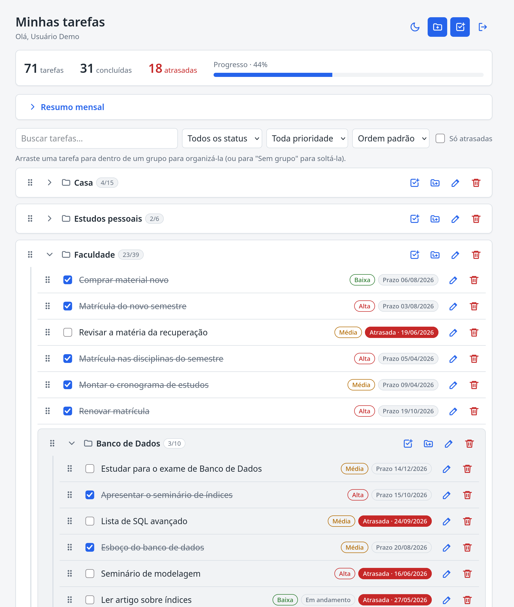
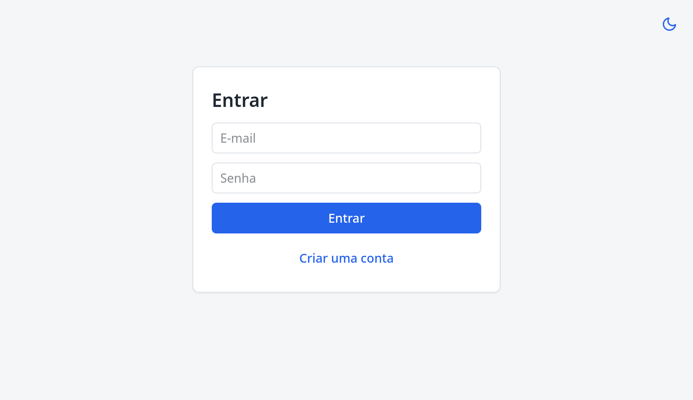
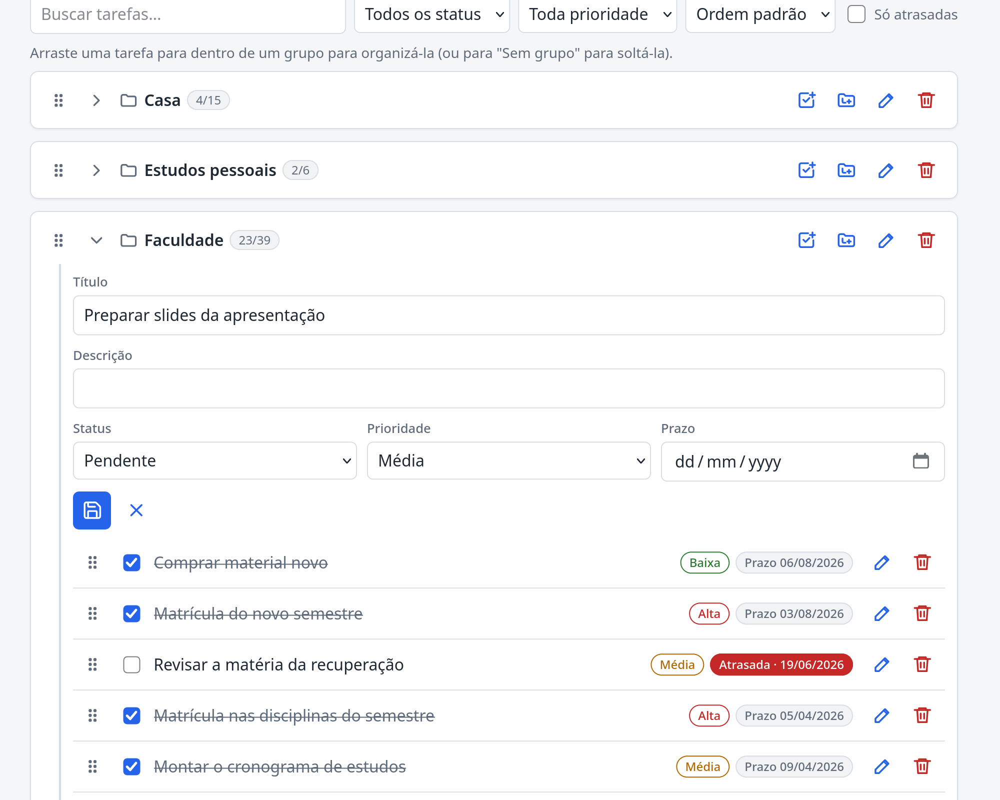
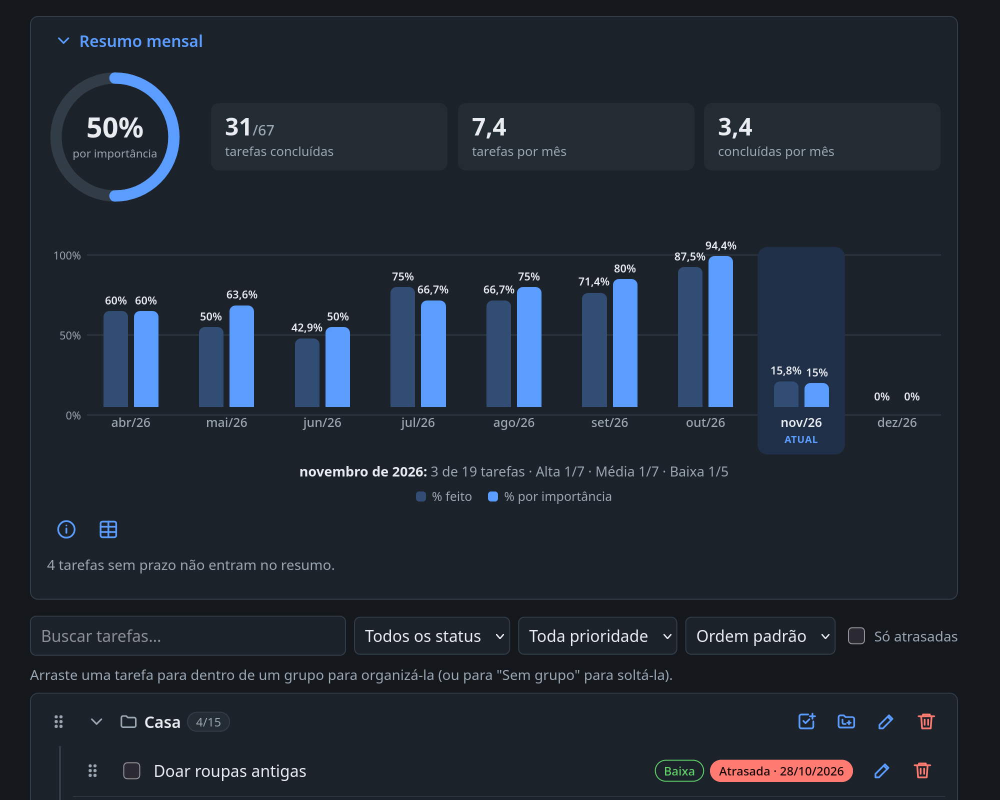
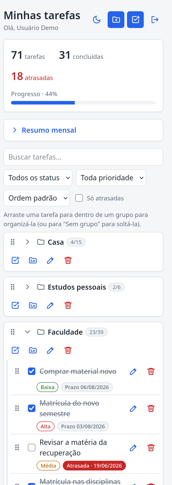
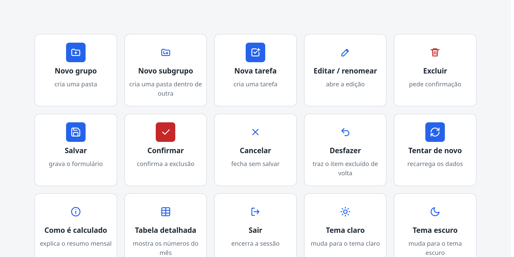

<div align="center">

# 📋 Tarefas

**Organize suas tarefas em grupos e subgrupos, acompanhe o progresso e veja quanto você realmente concluiu a cada mês.**




</div>

---

## 📖 Sobre o projeto

Aplicação web completa de gerenciamento de tarefas, composta por duas partes que funcionam juntas:

| Pasta                                                | O que é                                 | Entrega    |
| ---------------------------------------------------- | --------------------------------------- | ---------- |
| [`trabalho_1_crud_backend`](trabalho_1_crud_backend) | API REST em Node.js + Express + MongoDB | 1ª entrega |
| [`trabalho_2_frontend`](trabalho_2_frontend)         | Interface em React + TypeScript         | 2ª entrega |

Cada pessoa tem sua conta e vê apenas as próprias tarefas. As tarefas podem ser colocadas dentro de **grupos aninhados** (por exemplo, `Faculdade` › `Programação Web` › `Projeto final`), com até 10 níveis, e a tela principal mostra tudo como uma árvore que dá para reorganizar arrastando.

## 📸 Capturas de tela

<table>
  <tr>
    <td align="center" width="50%"><b>Login</b><br></td>
    <td align="center" width="50%"><b>Criar uma tarefa</b><br></td>
  </tr>
  <tr>
    <td align="center"><b>Resumo mensal</b><br></td>
    <td align="center"><b>Tema escuro</b><br></td>
  </tr>
  <tr>
    <td align="center" colspan="2"><b>No celular</b><br></td>
  </tr>
  <tr>
    <td align="center" colspan="2"><b>O que cada botão faz</b> (os botões mostram só o ícone; o nome aparece ao passar o mouse)<br></td>
  </tr>
</table>

> As capturas usam os dados do usuário de demonstração criado por `npm run seed` (veja [Como executar](#-como-executar)).

## ✨ Funcionalidades

**Conta e segurança**

- Cadastro, login e logout, com a sessão mantida por **cookie `HttpOnly`** (o JavaScript do navegador não consegue ler o token).
- Rotas protegidas: quem não está logado é levado ao login, e quem tem a sessão expirada volta ao login automaticamente.
- Cada usuário só acessa os próprios dados.

**Tarefas e grupos**

- Criar, editar, concluir e excluir tarefas, com título, descrição, status, prioridade e prazo.
- Criar, renomear, mover e excluir grupos e subgrupos (excluir um grupo com conteúdo pede uma confirmação extra).
- **Arrastar e soltar** (mouse, toque e teclado) para mover tarefas e grupos. Mover um grupo para dentro de si mesmo é bloqueado.
- **Desfazer** exclusões: o item some na hora e um aviso oferece "Desfazer" por 6 segundos.

**Encontrar e acompanhar**

- Busca por texto (ignora acentos), filtros por status, prioridade e "só atrasadas", e ordenação.
- Resumo no topo: total de tarefas, concluídas, atrasadas e barra de progresso.
- **Resumo mensal visual:** um anel com o avanço geral, três números-chave e um **gráfico de barras animado** por mês (pelo prazo), comparando o **% feito** com o **% por importância**, uma média ponderada em que tarefas de prioridade alta valem 3, média 2 e baixa 1. Passe o mouse (ou use o Tab) sobre um mês para ver o detalhe por prioridade; "Como é calculado" e "Tabela detalhada" ficam recolhidos até você pedir.

**Experiência de uso**

- Avisos de sucesso, de erro e de carregamento; mensagens claras quando a API está fora do ar.
- Funciona no computador e no celular, com **tema claro e escuro**: um botão sol/lua alterna entre eles, a escolha fica lembrada e, enquanto você não escolher, o app segue o tema do sistema.
- **Botões só com ícone e animados:** cada ação tem um desenho que a representa (pasta com "+", lixeira, disquete, seta de voltar…) e o botão reage ao mouse e ao teclado: a tampa da lixeira abre, o lápis escreve, o "+" gira, a seta da porta sai. Sem o texto, o nome da ação continua disponível para leitores de tela e como dica ao passar o mouse. Quem prefere menos movimento no sistema não vê as animações.
- Os grupos que você recolheu continuam recolhidos ao recarregar a página.

## 🛠️ Tecnologias

| Camada                 | Tecnologias                                                                                                       |
| ---------------------- | ----------------------------------------------------------------------------------------------------------------- |
| **Frontend**           | React 19, TypeScript, Vite, React Router, TanStack Query (React Query), dnd-kit, CSS puro (gráficos em SVG e CSS) |
| **Backend**            | Node.js, Express 5, TypeScript, Mongoose (MongoDB), Zod, JWT, bcryptjs, Helmet, express-rate-limit, Swagger UI    |
| **Banco**              | MongoDB 7 (via Docker Compose)                                                                                    |
| **Testes e qualidade** | Vitest, Testing Library, Supertest, mongodb-memory-server, ESLint, oxlint, Prettier, GitHub Actions               |

## 🚀 Como executar

### Pré-requisitos

- **Node.js 22.22 ou superior** (e o npm). Versões mais antigas não servem: o React Router 8 e o Vitest 5 exigem Node 22 ou mais novo
- **Docker** com Docker Compose, para subir o MongoDB (veja a alternativa sem Docker logo abaixo)

### Passo a passo

São três terminais: um para o banco, um para a API e um para a interface.

**1. Banco de dados** (na pasta `trabalho_1_crud_backend`)

```bash
cd trabalho_1_crud_backend
docker compose up -d
```

**2. Backend**

```bash
npm install
cp .env.example .env      # confira o JWT_SECRET (veja a tabela de variáveis)
npm run seed              # opcional: usuário de demonstração, com tarefas em cerca de 9 meses para o gráfico
npm run dev               # API em http://localhost:3000
```

**3. Frontend** (em outro terminal, na pasta `trabalho_2_frontend`)

```bash
cd trabalho_2_frontend
npm install
cp .env.example .env
npm run dev               # interface em http://localhost:5173
```

Abra **http://localhost:5173** e entre com o usuário de demonstração:

| E-mail           | Senha     |
| ---------------- | --------- |
| `demo@email.com` | `demo123` |

Se não rodou o `npm run seed`, clique em **"Criar uma conta"** na tela de login.

Outros endereços úteis: documentação da API (Swagger) em **http://localhost:3000/docs** e verificação de saúde em **http://localhost:3000/health**.

### Sem Docker

O Docker é só uma forma prática de ter o MongoDB. Você pode usar um MongoDB instalado na máquina (a `MONGO_URI` padrão já aponta para `localhost:27017`) ou um cluster gratuito do MongoDB Atlas, colocando a string de conexão em `MONGO_URI` no `.env` do backend.

### Para parar tudo

`Ctrl+C` nos terminais da API e da interface e, na pasta do backend, `docker compose down` (os dados continuam guardados; `docker compose down -v` apaga tudo).

## 🔧 Variáveis de ambiente

Cada projeto traz um arquivo `.env.example` para copiar para `.env`. O `.env` real nunca vai para o Git.

**Backend** (`trabalho_1_crud_backend/.env`)

| Variável         | Para que serve                                                   | Valor de exemplo                    |
| ---------------- | ---------------------------------------------------------------- | ----------------------------------- |
| `PORT`           | Porta da API                                                     | `3000`                              |
| `MONGO_URI`      | Conexão com o MongoDB                                            | `mongodb://localhost:27017/tarefas` |
| `JWT_SECRET`     | Segredo que assina o token de login. **Obrigatório em produção** | `troque-por-um-segredo-forte`       |
| `JWT_EXPIRES_IN` | Validade do token e do cookie                                    | `1d`                                |
| `NODE_ENV`       | `production` exige `JWT_SECRET` e marca o cookie como `Secure`   | `development`                       |
| `FRONTEND_URL`   | Única origem aceita pelo CORS (necessário para enviar cookies)   | `http://localhost:5173`             |

**Frontend** (`trabalho_2_frontend/.env`)

| Variável       | Para que serve  | Valor de exemplo        |
| -------------- | --------------- | ----------------------- |
| `VITE_API_URL` | Endereço da API | `http://localhost:3000` |

## 🧭 Como usar a aplicação

1. **Entre ou crie sua conta** na tela de login. Mensagens de erro (senha errada, e-mail repetido, API fora do ar) aparecem logo abaixo do formulário.
2. **Crie um grupo** com o botão de **pasta com "+"** (_Novo grupo_, por exemplo `Faculdade`). Na linha do grupo, a **pasta com degrau** cria um subgrupo dentro dele e a **caixa com visto e "+"** cria uma tarefa. Passe o mouse sobre qualquer botão para ver o nome da ação (a legenda completa está nas [capturas de tela](#-capturas-de-tela)).
3. **Preencha a tarefa:** título, descrição, status, prioridade e prazo. Salve com o **disquete** (ou `Enter`) e cancele com o **X** (ou `Esc`).
4. **Conclua** uma tarefa marcando a caixinha à esquerda. O progresso no topo e os contadores dos grupos se atualizam na hora.
5. **Reorganize arrastando** pela alça `⠿`: solte uma tarefa em outro grupo para movê-la, ou na área **"Sem grupo"** para tirá-la do grupo. Grupos também podem ser arrastados para dentro de outros.
6. **Encontre o que precisa** com a busca, os filtros e a ordenação.
7. **Abra o Resumo mensal** para ver o anel de avanço geral e o gráfico mês a mês (no celular, o gráfico abre rolado até o mês atual). Passe o mouse sobre um mês para ver o detalhe por prioridade; o botão da **tabela** mostra os números exatos e o do **"i"** explica como os dois percentuais são calculados.
8. **Excluiu sem querer?** Toque na **seta de voltar** (_Desfazer_) no aviso que aparece por 6 segundos. A lixeira pede uma confirmação (visto para confirmar, X para desistir).
9. **Troque o tema** no botão sol/lua do topo (disponível também na tela de login).
10. **Recolha** grupos com a seta ao lado do nome. A tela lembra quais estavam recolhidos.
11. Use o ícone da **porta com seta** (_Sair da conta_) para encerrar a sessão.

> Tarefas **sem prazo** não entram no resumo mensal (o mês vem do prazo), mas o resumo avisa quantas ficaram de fora.

## 🔐 Como funciona a autenticação por cookies

```text
Navegador                                   API
   │  POST /auth/login  {email, senha}        │
   │ ───────────────────────────────────────▶ │  confere a senha (bcrypt) e gera o JWT
   │ ◀─────────────────────────────────────── │  Set-Cookie: token=…; HttpOnly; SameSite=Lax
   │                                          │
   │  GET /grupos/arvore   (cookie automático)│
   │ ───────────────────────────────────────▶ │  lê o JWT do cookie e filtra pelo usuário
   │                                          │
   │  POST /auth/logout                       │
   │ ───────────────────────────────────────▶ │  apaga o cookie
```

- O frontend nunca guarda o token: toda requisição usa `credentials: 'include'` e o navegador envia o cookie sozinho.
- O estado "logado" vem de `GET /auth/me`. Um `401` em qualquer chamada leva de volta ao login.
- O cookie é `HttpOnly` (protege contra roubo por XSS), `SameSite=Lax` (protege contra CSRF) e `Secure` em produção.
- O CORS aceita somente a origem definida em `FRONTEND_URL`, com credenciais.
- Contra tentativas de adivinhar senhas, `POST /auth/login` e `POST /auth/register` aceitam **20 tentativas a cada 15 minutos por IP** (depois disso, erro 429). `GET /auth/me` e `POST /auth/logout` não entram nessa conta, então recarregar a página não gasta a cota.

## 🔌 API

A documentação interativa fica em **http://localhost:3000/docs** (Swagger). Resumo das rotas; todas, exceto as de cadastro e login, exigem sessão.

| Método           | Rota                     | Descrição                                                           |
| ---------------- | ------------------------ | ------------------------------------------------------------------- |
| POST             | `/auth/register`         | Cadastra usuário                                                    |
| POST             | `/auth/login`            | Autentica e grava o cookie                                          |
| GET              | `/auth/me`               | Usuário logado                                                      |
| POST             | `/auth/logout`           | Encerra a sessão                                                    |
| GET, POST        | `/grupos`                | Lista (paginada) e cria grupos                                      |
| GET              | `/grupos/arvore`         | Árvore completa: grupos › subgrupos › tarefas                       |
| GET, PUT, DELETE | `/grupos/:id`            | Consulta, renomeia/move e exclui (`?cascata=true` apaga o conteúdo) |
| GET, POST        | `/tarefas`               | Lista (paginada, com filtros) e cria tarefas                        |
| GET              | `/tarefas/resumo-mensal` | Conclusão por mês, com média ponderada (`?ano=` opcional)           |
| GET, PUT, DELETE | `/tarefas/:id`           | Consulta, atualiza e exclui                                         |
| GET              | `/health`                | Verifica a API e o banco                                            |

## 🗂️ Organização do projeto

```text
.
├── .github/workflows/ci.yml       integração contínua (GitHub Actions): backend e frontend
├── docs/screenshots/              capturas de tela usadas neste README
├── trabalho_1_crud_backend/       API (Express + MongoDB)
│   ├── src/
│   │   ├── config/                variáveis de ambiente, conexão com o banco, Swagger
│   │   ├── models/                schemas do Mongoose (User, Group, Task)
│   │   ├── schemas/               validação de entrada com Zod
│   │   ├── routes/                definição das rotas
│   │   ├── controllers/           camada HTTP (sem regra de negócio)
│   │   ├── services/              regras de negócio (grupos, ciclos, resumo, auth)
│   │   ├── middlewares/           autenticação, validação, rate limit, erros
│   │   ├── seed.ts                script que grava os dados de demonstração
│   │   └── seed-dados.ts          árvore de exemplo e 8 meses de histórico (testável, sem banco)
│   └── tests/                     testes automatizados
└── trabalho_2_frontend/           interface (React + TypeScript)
    └── src/
        ├── pages/                 telas: LoginPage e DashboardPage
        ├── components/            componentes reutilizáveis (GrupoItem, TarefaLinha, formulários…)
        ├── hooks/                 lógica de dados e estado (sessão, árvore, avisos, resumo)
        ├── services/              cliente da API (`api.ts`)
        ├── lib/                   tipos e funções puras (árvore, arrastar e soltar, resumo mensal, tema)
        └── test-utils/            dados de exemplo compartilhados pelos testes
```

O fluxo de uma requisição na API é `rota → autenticação → validação (Zod) → controller → service → model`, com tratamento de erros centralizado. Mais detalhes em [`trabalho_1_crud_backend/roadmap.md`](trabalho_1_crud_backend/roadmap.md).

## 💡 Decisões de projeto

- **Cookie `HttpOnly` em vez de `localStorage`:** o token fica fora do alcance do JavaScript da página, o que reduz o estrago de uma falha de XSS.
- **Grupos como lista de adjacência:** cada grupo guarda só o `pai`. A profundidade e a subárvore são consultadas no próprio banco com `$graphLookup`, e ciclos e disputas entre requisições simultâneas são tratados na camada de serviço.
- **React Query com atualização otimista:** a tela responde na hora, e desfaz a mudança se a API recusar.
- **Desfazer por adiamento:** em vez de recriar o item depois de apagá-lo (o que mudaria seu ID), a exclusão só é enviada à API depois dos 6 segundos. Sair da conta confirma as exclusões pendentes antes.
- **Média ponderada no resumo mensal:** concluir uma tarefa de prioridade alta pesa mais que uma baixa (pesos 3, 2 e 1, definidos em `PESOS` no `summary.service.ts`).
- **CSS puro, tema com `light-dark()`:** cada cor é escrita uma vez só, com a versão clara e a escura lado a lado. O botão de tema grava `data-tema` no `<html>` e um pequeno script no `index.html` o aplica antes da primeira pintura, para a página não piscar no tema errado.
- **Gráfico sem biblioteca:** o anel e as barras são SVG e CSS puros, animados só com CSS (e desligados para quem pede menos movimento). Cada coluna tem uma descrição completa para leitores de tela, e a tabela detalhada continua disponível.
- **Botões só com ícone, acessíveis:** um único componente (`BotaoIcone`) recebe o ícone e um `rotulo` que descreve a ação exata; ele vira `aria-label` e `title`. As animações ficam no CSS: cada ícone tem as partes que se mexem (tampa, seta, "+") com classe própria, acionadas por `:hover` e `:focus-visible`, e `prefers-reduced-motion` as desliga. A tela de login mantém o texto, porque ali o botão é o próprio formulário.
- **Dados de demonstração com histórico:** o `seed` gera tarefas em 8 meses ao redor de hoje, sempre relativas à data em que roda (sem sorteios, então o resultado é reproduzível), para o gráfico do resumo mensal aparecer cheio e com valores diferentes a cada mês.
- **Desenvolvimento orientado a testes:** as funcionalidades novas foram escritas começando pelos testes.

## ✅ Testes e qualidade

```bash
# Backend (na pasta trabalho_1_crud_backend)
npm test              # 89 testes; usam um MongoDB em memória, não precisam do Docker
npm run lint
npm run typecheck

# Frontend (na pasta trabalho_2_frontend)
npm test              # 166 testes
npm run lint
npm run build         # checa os tipos e gera a versão de produção
```

O repositório traz um workflow do GitHub Actions (`.github/workflows/ci.yml`, na raiz) que roda em todo push e pull request, com um job para cada projeto: **backend** (`npm ci`, lint, typecheck e testes) e **frontend** (`npm ci`, lint, build e testes). Os testes do backend usam um MongoDB em memória, então o CI não precisa de serviços extras.

## 🩺 Solução de problemas

| Sintoma                                                    | Causa provável                                                               | O que fazer                                                                                       |
| ---------------------------------------------------------- | ---------------------------------------------------------------------------- | ------------------------------------------------------------------------------------------------- |
| `npm run dev` do backend não mostra nada e fica parado     | O MongoDB não está rodando                                                   | `docker compose up -d` na pasta do backend                                                        |
| Tela mostra "Não foi possível conectar ao servidor"        | API fora do ar, ou bloqueio de CORS                                          | Confirme a API em http://localhost:3000/health e que a interface abriu em `http://localhost:5173` |
| Erro de CORS ao entrar                                     | O Vite subiu em outra porta (ex.: 5174) porque a 5173 estava ocupada         | Libere a 5173 e reinicie o Vite, ou ajuste `FRONTEND_URL` no `.env` do backend e reinicie a API   |
| Login funciona mas a sessão não se mantém                  | Frontend e API em sites diferentes (`SameSite=Lax`)                          | Use `localhost` nos dois, ou hospede ambos sob o mesmo site                                       |
| "Muitas tentativas. Tente novamente mais tarde." ao entrar | Mais de 20 logins ou cadastros em 15 minutos a partir do mesmo IP (erro 429) | Aguarde até 15 minutos, ou reinicie a API em desenvolvimento (o contador fica em memória)         |
| `docker compose` não encontrado                            | Docker não instalado                                                         | Instale o Docker, ou use um MongoDB local/Atlas (veja [Sem Docker](#sem-docker))                  |

## ⚠️ Limitações conhecidas

- Se a aba for fechada ou recarregada nos 6 segundos do "Desfazer", a exclusão não é enviada e o item volta.
- O login também devolve o token no corpo da resposta, para facilitar o uso pelo Swagger. O frontend ignora esse valor e usa só o cookie.
- Em produção, com interface e API em domínios diferentes, `SameSite=Lax` não basta: seria preciso servir os dois sob o mesmo site.
- O tema claro/escuro usa `light-dark()` do CSS, presente em navegadores recentes (Chrome 123+, Firefox 120+, Safari 17.5+).
- Sem texto nos botões, o nome da ação aparece como dica ao passar o mouse; em telas de toque não há dica, então os ícones precisam falar por si (veja a legenda nas capturas de tela).
- O mês do resumo mensal vem do **prazo** (o sistema não guarda a data de conclusão) e é calculado em UTC.
